


**Ko'p obyektli tarmoqni bitta paneldan boshqarish tizimi.** Har bir obyektdagi MikroTik serverga bitta qator bilan ulanadi va o'zi WireGuard tunnel ochadi. Shundan keyin ichki tarmoqdagi kameralar va boshqa qurilmalar markazdan ko'rinadi.

---

## Ulash qanday ishlaydi

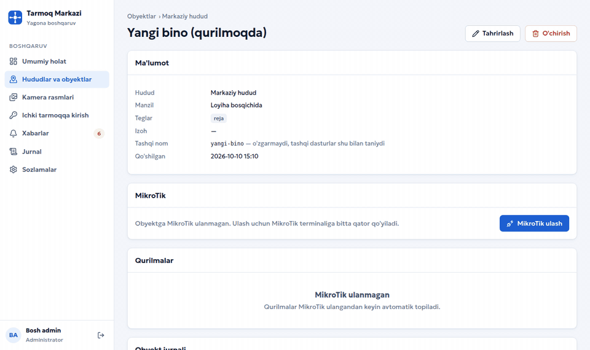

Obyektda faqat MikroTik va kameralar bo'lsa ham yetadi: kompyuter, oq IP yoki port ochish kerak emas.

1. Panelda **«MikroTik ulash»** bosiladi va bir martalik qator olinadi. Qator 1 soatdan keyin eskiradi va faqat bir marta ishlaydi.
2. Qator MikroTik terminaliga qo'yiladi. Skript avval RouterOS versiyasini (kamida 7.23.7) va device-mode holatini tekshiradi, xato bo'lsa sababini o'zbekcha yozadi.
3. MikroTik serverga o'z ma'lumotini yuboradi va panelda **«MikroTik topildi»** yozuvi chiqadi. Admin tasdiqlamaguncha tunnel ishga tushmaydi.
4. Tasdiqlangach MikroTik onlayn bo'ladi va ichki tarmoqdagi qurilmalar avtomatik topiladi.

## Asosiy imkoniyatlar

| | |
|---|---|
| 🔌 **Bir qatorli ulash** | Tunnel, manzil, filtr va MSS qoidalarini skript o'zi yozadi. Tizim MikroTik'da faqat serverdan kira oladigan alohida hisob ochadi, admin paroli egasining o'zida qoladi |
| 🧭 **Manzillar to'qnashmaydi** | Har obyekt alohida virtual blok oladi (`192.168.88.0/24 → 10.100.3.0/24`, netmap). Hamma obyektda bir xil `192.168.88.x` bo'lsa ham ishlaydi |
| 🔎 **Qurilmalarni topish** | DHCP, ARP, bridge jadvali va `ip-scan` natijasi MAC bo'yicha birlashtiriladi. Ishlab chiqaruvchi IEEE OUI bo'yicha, kamera modeli ONVIF orqali aniqlanadi |
| 📊 **Umumiy holat** | Uzilgan va muammoli MikroTik'lar ro'yxat tepasida turadi. Har biri uchun javob vaqti, internet va tunnel tezligi, protsessor yuklamasi ko'rinadi. Pastda server holati: protsessor, xotira, disk, internet, tunnel, baza, video |
| 🖥️ **Qurilma sahifasi** | Kamera yoki registratorning o'z veb-sahifasi server orqali ochiladi. Ruxsat 30 daqiqa amal qiladi |
| 🔐 **VPN profil** | WireGuard profili QR yoki `.conf` ko'rinishida beriladi, maxfiy kalit serverda saqlanmaydi. Profil faqat obyektlar tarmog'iga o'tkazadi, routerlar esa bir-biriga o'ta olmaydi |
| 📷 **Kamera rasmlari** | Har N daqiqada har kameradan bitta kadr olinadi va kunlik lentada saqlanadi. Diskda 2 GB dan kam joy qolsa, eng eski rasmlar o'chiriladi |
| 🔔 **Ogohlantirish** | MikroTik yoki kamera o'chib-yonsa, xabar ilova ichida ham, Telegram guruhida ham chiqadi |
| 🔗 **Integratsiya API** | Tashqi dastur alohida kalit bilan kameralar ro'yxatini, joriy kadrni va saqlangan rasmlarni oladi. Webhook har yangi rasmda `HMAC-SHA256` imzosi bilan yuboriladi |
| 🧾 **Jurnal** | Kim qaysi kamerani ochgani va nimani o'zgartirgani «oldin → keyin» ko'rinishida yoziladi |

## Ekranlar

<table>
<tr>
<td width="50%">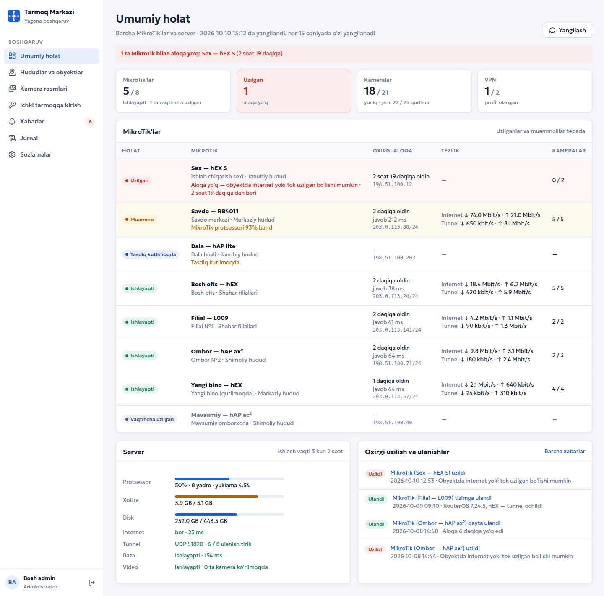 <b>Umumiy holat</b>: barcha MikroTik'lar holati (uzilganlar tepada) va server ko'rsatkichlari</td>
<td width="50%">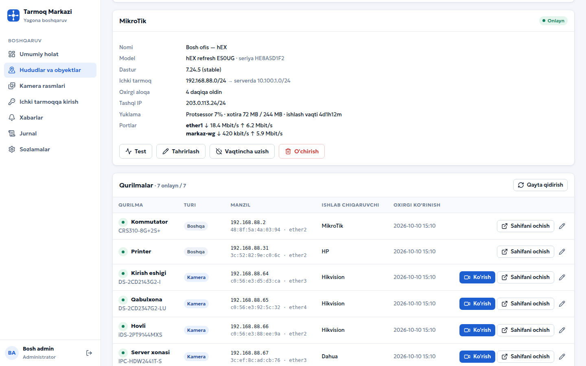 <b>Obyekt</b>: MikroTik ma'lumoti, portlar tezligi va topilgan qurilmalar</td>
</tr>
<tr>
<td>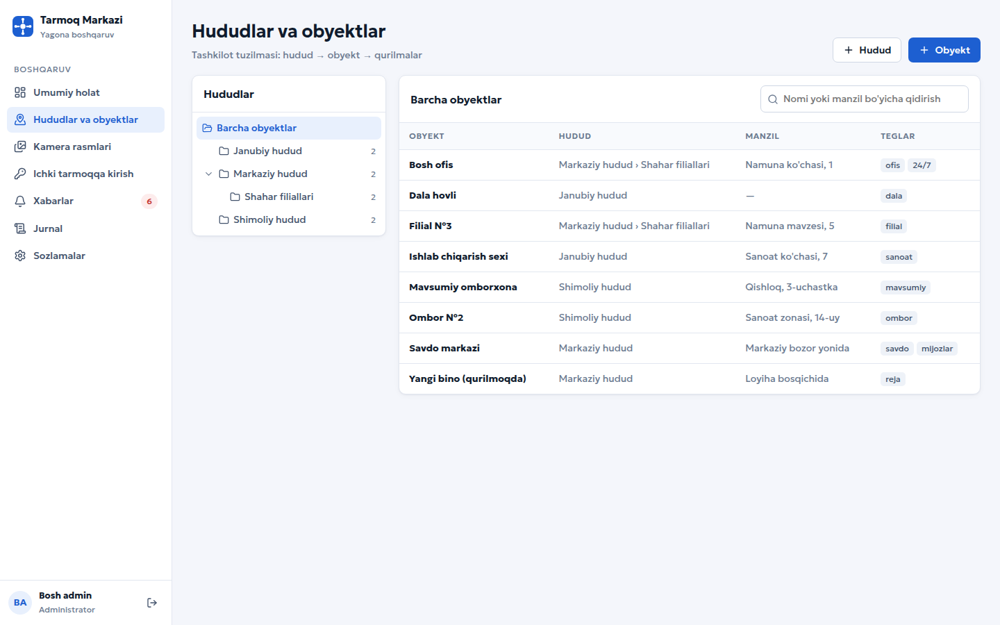 <b>Hudud → obyekt</b> daraxti, teglar va qidiruv</td>
<td>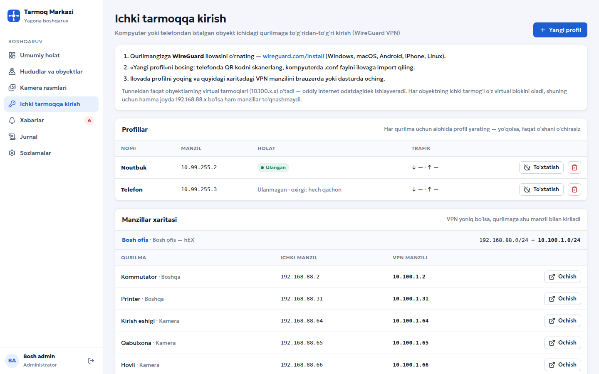 <b>VPN</b>: profillar va manzillar xaritasi (ichki IP → VPN manzili)</td>
</tr>
<tr>
<td>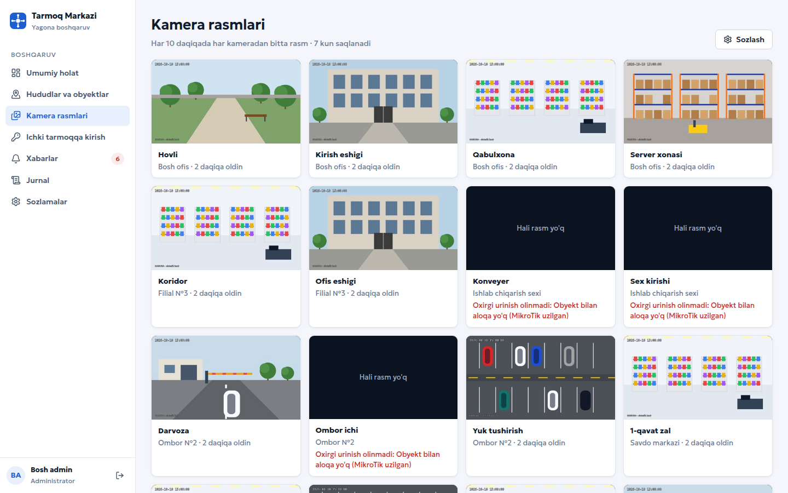 <b>Kamera rasmlari</b>: har kameradan oxirgi kadr, olinmagan kadr sababi bilan</td>
<td>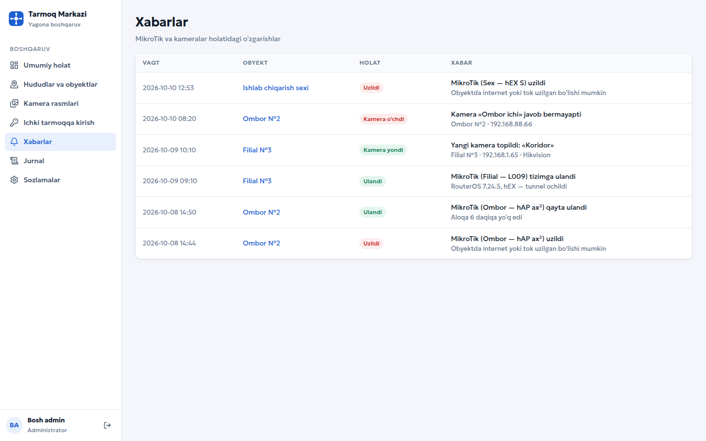 <b>Xabarlar</b>: uzilish, qayta ulanish va yangi qurilmalar</td>
</tr>
<tr>
<td>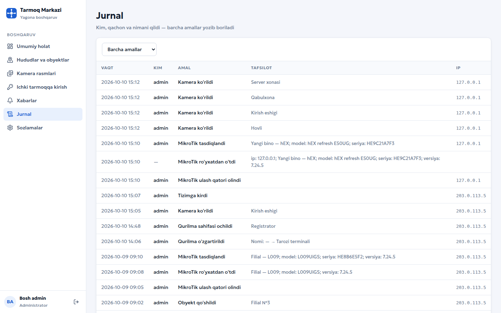 <b>Jurnal</b>: amallar tafsiloti va IP manzil bilan</td>
<td>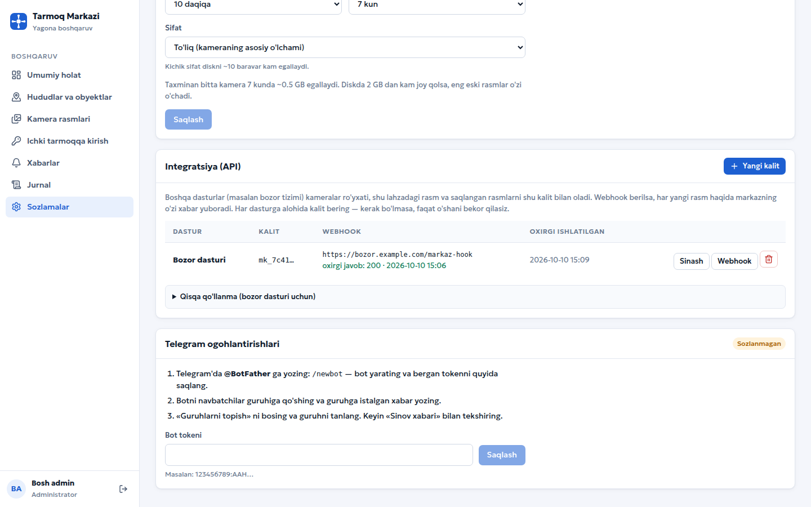 <b>Sozlamalar</b>: integratsiya kalitlari, webhook va Telegram</td>
</tr>
</table>

> Suratlardagi obyektlar, qurilmalar, IP manzillar (hujjatlar uchun ajratilgan `203.0.113.x` va `198.51.100.x` diapazonlari) va kamera kadrlari **namuna ma'lumot**. Kadrlar sintetik rasm, haqiqiy kamera tasviri emas.

## Arxitektura

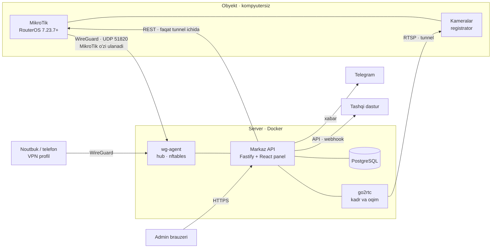

- **MikroTik** tunnel orqali faqat serverning ichki manzilidan kelgan so'rovni qabul qiladi. Tizim hisobi ham shu manzilga bog'langan.
- **wg-agent** alohida konteynerda host tarmog'ida ishlaydi. Panel u bilan Unix soket orqali gaplashadi va faqat ruxsat etilgan amallarni bajara oladi.
- **Video:** go2rtc kamera oqimini faqat kerak bo'lganda tortadi. H.265 ni ocha olmaydigan brauzer uchun H.264 zaxira manbasi bor.
- **Sirlar** (MikroTik hisoblari, kamera loginlari, Telegram tokeni) AES-256-GCM bilan shifrlanadi. Parollar Argon2id bilan xeshlanadi, sessiya bazada saqlanadi, har so'rovda `Origin` tekshiriladi.

## Sifat

- `vitest` — **67 ta sinov** (11 fayl), haqiqiy PostgreSQL va haqiqiy go2rtc bilan: kirish va telefon kodi, huquq doirasi, ulash oqimi, qurilma topish, video, rasmlar, VPN, xabarlar, integratsiya API.
- Ulash skripti QEMU'dagi virtual RouterOS (CHR 7.23.7) da sinalgan: oddiy ulanish, device-mode qulfi va server topilmagan holat.

## Texnologiyalar

Node 22 · TypeScript · Fastify 5 · Kysely · PostgreSQL 18 · React 19 · Vite · TanStack Query · WireGuard · nftables · go2rtc · Caddy · Docker Compose

## Jonli

🌐 [markaz.geonazorat.uz](https://markaz.geonazorat.uz) — kirish faqat egasi uchun.

---

**Manba kodi yopiq.** Namoyish yoki hamkorlik bo'yicha: Telegram [@Humoyun_Davronov](https://t.me/Humoyun_Davronov)

Muallif — Humoyun Davronov

